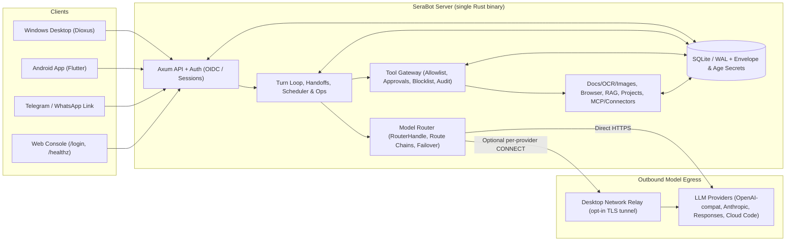

<p align="center">
  
</p>

<h1 align="center">SeraBot</h1>

<p align="center">A self-hosted team of AI bots for a small, trusted circle.<br>
Deterministic Rust around bounded LLM calls.</p>

---

## What it is

SeraBot (`0.74.3`) is an invitation-only, multi-user self-hosted agent built as **one Rust binary** and **one SQLite/WAL database**. Each invited member signs in with Microsoft OIDC and gets an isolated, UID-scoped workspace—chats, bot fleet, skills, memory, documents, project folders, AI provider accounts, connectors, and an encrypted vault. Nobody can read another member's data or credentials.

| Part | Stack | What it does |
| --- | --- | --- |
| **Server** ([`crates/serabot`](crates/serabot)) | Rust + Axum + SQLite/WAL | Multi-user API, bot runtime & handoffs, tool gateway, approvals, audit log, scheduler, document/browser/RAG pipelines |
| **Windows desktop** ([`crates/serabot-desktop`](crates/serabot-desktop)) | Rust + Dioxus Desktop (WebView2) | Primary console: chats, turn traces, Projects code workspace, live browser view, Vault, Usage Insights, local folders, ACP Claude Code, network relay |
| **Android app** ([`apps/serabot_mobile`](apps/serabot_mobile)) | Flutter | Mobile console: chat, approvals, fleet management, bot Library, reply traces, costs, job search, alert & brief settings |
| **Telegram** | Bot API (long-poll) | Per-user linked chat (`/start <code>`), voice notes, `/auto` · `/voice` · `/text` replies, file delivery, and ops alerts |
| **WhatsApp linked device** | `whatsapp-rust` (unofficial) | Opt-in spare-number linked device per member (`enabled = true` by default); allowlisted 1:1 chats routed to the `whatsapp` bot |

---

## Highlights

### Bots, teamwork & model routing

- **22-bot fleet with built-in fallback:** Seeds 15 default bots per user from [`bots/`](bots/) and [`prompts/`](prompts/) (`main`, `analyst`, `maker`, `watcher`, `legal`, `comptable`, `auditor`, `marketer`, `markets`, `courier`, `whatsapp`, `inbox`, `jobfinder`, `hostinger`, `mailbox`) plus 7 catalog-only marketplace bots (`researcher`, `writer`, `translator`, `planner`, `support`, `product`, `tutor`), with compiled-in fallback in [`shipped.rs`](crates/serabot/src/shipped.rs) and 36 shipped skills in [`skills/`](skills/).
- **Bounded orchestration:** `main` is the only orchestrator and fans out up to 16 parallel `delegate` handoffs per turn (or bots collaborate via `ask_teammate`), tracked in an idempotent `handoffs` ledger with automatic `failed_resumable` resume, `waiting_model` parking, and context compaction.
- **Fleet management tools:** `main` can inspect (`bot_list`, `bot_read`, `model_list`, `handoff_status`) and—with per-call owner approval—adjust routes, delegates, and retries (`bot_set_route`, `bot_set_enabled`, `bot_set_delegates`, `subagent_retry`) via one audited `fleet_mutation` path that never widens tool/egress permissions.
- **Per-user provider accounts & route chains:** Multiple sealed accounts per member across OpenAI-compatible providers (`mistral`, `deepseek`, `minimax`, `minimax-cn`, `openai`, `groq`, `together`, `fireworks`, `openrouter`, `xai`, `cerebras`, `moonshot`, `perplexity`), `anthropic`, `muse-code`, `google-antigravity`, `openai-codex`, `github-copilot`, and `opencode-go`/`opencode-zen`. Each bot carries a head route + up to 2 fallbacks with single-flight token refresh, cooldown/quota holds, live router swaps (`RouterHandle`), and model-aware thinking levels (`off` to `max` in [`thinking.rs`](crates/serabot/src/thinking.rs)).

### Chat experience

- **Per-reply turn traces & memory attribution:** Each assistant reply owns its collapsed step trace (`turn_trace.rs`), including recalled, saved, held, and superseded memories (`turn.memory`), auto-expanding on failures or pending approvals.
- **Context meter & immediate cancellation:** `turn.context` events feed a live context-window meter in the chat header bar; Stop aborts in-flight HTTP model calls, compaction, and queued tasks immediately via `CancellationToken`.
- **Desktop chat ergonomics:** Virtualized feed, runs sidebar, composer queue with steer and `@bot` mentions, multimodal image vision across all four wire transports + inline Office excerpts, drag-and-drop file uploads, Markdown export, `Ctrl+K` command palette, and per-bot Library tab.
- **0.74.1–0.74.2 UI redesigns:** Redesigned **Conversation history** (grouped history + full-text message search via `/v1/conversations/search`), alongside redesigned **Workflows**, **Projects**, **Memory**, and **Tasks / Kanban / Calendar** views.

### Memory

- **Hybrid keyword + semantic recall:** Combines BM25 matching with local E5 embeddings per fact (`memory_vectors.rs`, using `[embeddings]`) and optional Mem0 Platform recall (`conn.mem0`).
- **Write-time contradiction check:** After owner turns save facts (`runtime/conflicts.rs`), a bounded check retires older contradicted facts (`superseded`, restorable) or holds extracted guesses that conflict with owner-written facts for review.
- **Weekly memory review:** Surfaces up to 10 contradicted, duplicated, or stale memories for keep/edit/merge/delete curation on the Memory page.

### Documents & deliverables

- **Cited RAG & Office suite:** Local chunking + E5 vector retrieval (`rag_search`, `document_index`), plus deterministic read/inspect/edit/build tools for Word (`.docx`), Excel (`.xlsx`), PowerPoint (`.pptx`, `deck_build` via `deckcraft-pptx`), and PDF (`pdf_ops.rs`).
- **OCR & audio:** Automatic Mistral OCR fallback and embedded JPEG/PNG page extraction for scanned PDFs; Voxtral transcription, audio understanding, and TTS voice replies (`/auto`, `/voice`, `/text`, falling back to the member's own Mistral account).
- **Image tools & research reports:** Non-destructive server tools (`image_crop`, `image_rotate`, `image_adjust`, `image_compress`, `images_to_pdf`, `pdf_to_images` with EXIF rotation and metadata stripping) and `research_report_build` for cited Word/PDF reports backed by 10–20 read sources.

### OneDrive

- Per-user Microsoft Graph OAuth (PKCE), scoped strictly to each member's own drive.
- **0.74.1 improvements:** Browse the entire own drive from the root, search files, inspect recent files and file metadata (`info`), import a file and read it with the matching document/media tool, and run approval-gated uploads to the dossier or a chosen folder.

### Browser automation

- **Per-user server browser:** Isolated headless Chromium profiles (`provider = "spawn"`, up to 8 profiles per user) with live screenshot streaming and one-click human takeover/handback in the desktop Browser tab.
- **Reliable interaction:** Actionability checks before clicks/typing, automatic cookie/consent banner dismissal (`auto_dismiss_banners`), role/text locators (`browser_find`, `browser_wait`, `browser_select`, `browser_check`, `browser_scroll`, `browser_hover`), light resource mode, and host-bound Vault autofill (`local`, `1Password`, `Proton Pass`—values never leave the server to the model).
- **0.74.1 download & PDF improvements:** Browser downloads that open directly in the PDF viewer, download by URL inside the member's authenticated browser session, save the current document, and provide a next-step reader hint; `browser_upload` and `browser_forget_logins` remain approval-gated.

### Projects workspace

- **Contained project folders:** Organizes files under `<inbox>/<user>/projects/<slug>/` with path-traversal/symlink containment and attachment relocation tracking.
- **0.74.1 Projects page & code workspace:** Redesigned Projects page featuring a **file tree**, a caret-stable **editor** with line-number gutter saving via `PUT /v1/projects/{slug}/files/{*path}`, a per-project **check harness** (`diagnostics.rs`, allowlisted `cargo`/`rustc` without a shell, 2 MB output cap, 120 s timeout, approval-gated `project_check` tool), and a **Problems panel** with click-through to the exact diagnostic file and line.
- *(Note: Desktop `rust-analyzer` LSP integration in [`docs/specs/lsp-workspace.md`](docs/specs/lsp-workspace.md) is a proposed 0.75 design awaiting owner approval and is not implemented.)*
- *(Note: on-demand tool packs (`pack_list`/`pack_load`, tool groups loaded per task) are a proposed 0.75 design in [`docs/specs/tool-packs.md`](docs/specs/tool-packs.md) awaiting owner approval and are not implemented.)*

### Workflows & routines

- Active multi-step checklist plans (`/v1/workflows/*`) resumable by the orchestrator, plus per-user scheduled routines (`/v1/routines/*`) with customizable local time, timezone, and prompts—backed by the redesigned **Workflows** page in `0.74.1`.

### Jobs (`jobfinder`)

- **First-chat interview & site watcher:** Configures a per-user job profile (roles, cities/remote, sector, languages, exclusions, frequency, optional OneDrive tracker/CV folder) and watches Moroccan job sites (`emploi-public.ma`, `alwadifa-maroc.com`, `anapec.org`, `rekrute.com`, `emploi.ma`, `dreamjob.ma`, `stagiaire.ma`, `marocannonces.com`) plus up to 10 user-added sources, respecting `robots.txt` on scheduled runs.
- **Application pipeline:** Tracks `saved` → `applied` → `interview` → `offer` / `rejected`, turns concours deadlines into tasks, and updates the member's OneDrive Excel tracker (with approval-gated upload). *(Built-in listing URLs/parsers are tested against synthetic fixtures only; verify live sites on your server.)*

### Morning brief & email triage

- **Morning brief (`brief/morning.rs`):** Daily member summary (on by default, `06:00 UTC`) covering deadlines, calendar events, due tasks, new job matches, Outlook mail subjects, monthly spend vs. budget, and recent alerts.
- **Email triage:** Daily opt-in `inbox` bot pass (off by default, `07:00 UTC`) grouping the last 24 hours of mail into important / needs reply / FYI / noise and drafting replies; sending remains approval-gated.

### Integrations & marketplace

- **Schema v2 MCP Marketplace (`/v1/marketplace/*`):** Installed/enabled `http` MCP plugins expose `plugin.<slug>.<tool>` through the gateway with public-IP pinning, egress allowlists, MCP OAuth (`mcp_oauth.rs`: RFC 9728/8414 discovery, CIMD/DCR, PKCE S256, RFC 7009 revoke), multi-account support, per-tool enable/approval switches, and `suggest_marketplace_app` chat cards.
  - Eight real remote OAuth manifests live in [`plugins/`](plugins/) (`linear`, `notion`, `sentry`, `vercel`, `stripe` read-only, `posthog`, `context7`, `atlassian` — tested with synthetic wiremock fixtures, unverified live).
  - Placeholder manifests (`*.example.invalid`) and `stdio` plugins stay blocked.
- **Library (0.74.9):** image cards with real thumbnails and a full image viewer (zoom, prev/next) on desktop and mobile, in-app previews for PDF (existing viewer) plus PowerPoint (slide titles/text) and Excel (sheet names + first rows) via `GET /v1/library/preview-doc`, and **Open with default app** for every item (desktop: OS default opener; mobile: system share sheet) alongside Show in Explorer / Save to Downloads. The 0.74.8 page (tabs, search, date & sort, upload) still stands — every file the bots made in any chat plus your own uploads via `/v1/library*`, mirrored by default to your OneDrive (`SeraBot Library` folder; `social_extract` image downloads land there too). `[library]` in the server config turns it or the mirror off.
- **Native connectors:** GitHub App device-flow connector (`github.*`), native per-user **SMTP/IMAP Mail** (`mail_send` approval-gated with attachments and a per-account signature, `mail_list`, `mail_read` with attachment listing, `mail_folders`, `mail_search`, approval-gated `mail_flag`/`mail_move`/`mail_delete` over hand-rolled `tokio-rustls` wire clients via `/v1/mail/*`, multi-account since 0.74.4 with an optional `account` label per mailbox, plus a desktop mail window that appears only while a mailbox is connected — e.g. Hostinger), dedicated `hostinger` (single Hostinger mailbox) and `mailbox` (multi-account) bots, Google Drive/Sheets/Calendar/Gmail, Outlook & Outlook Calendar, Notion, AgentMail, Todoist, Slack, Exa, WhatsApp Business Cloud API, ElevenLabs MCP, Firecrawl, Tavily, **`social_extract`** (social media extractor: post metadata + image/video URLs + optional artifact download, granted to every bot), and **Composio** (per-user `ak_` / `uak_` / `ck_` Connect MCP keys).

### Claude Code via ACP (desktop-only exception)

- Integrates `@agentclientprotocol/claude-agent-acp` directly into per-bot desktop chat using the member's own Node.js 22+ and Claude login ([`docs/specs/claude-code-acp.md`](docs/specs/claude-code-acp.md)).
- Runs **only on the Windows desktop** (never on the server), confined to one chosen allowed local folder, with a filtered child environment, `@`-file mention autocomplete, image blocks, no terminal capability, and explicit **Allow** / **Decline** cards for every edit or command (no `"always"` grant).

### Messaging (Telegram & WhatsApp)

- **Telegram:** Members link their own Telegram chat with a one-time `/start <code>` token. `telegram_reply_file` replies in-thread without approval; `telegram_send_document` delivers to the member's own linked chat without a card while `"send files to my own chats without asking"` is enabled (default, 50/day cap, audited as `delivery.own_chat`).
- **WhatsApp linked device:** Uses `whatsapp-rust` (unofficial client—use a spare number; enabled by default, turn off via `[whatsapp_link] enabled = false`). Strictly limited to allowlisted 1:1 chats (no groups, contacts, or pre-pair history), routed solely through the `whatsapp` bot (`ask_teammate` reaches other bots). Handles voice-note transcription, `/auto` voice replies, photo batching (up to 10 photos in 8 s) with OCR/image-to-PDF tools, `whatsapp_link_send` and `whatsapp_link_reply_file` (allowlist-only, 6/min and 100/day caps), and idle presence (`presence_idle_secs`).

### Desktop network relay

- Opt-in per provider (`google-antigravity`, Gemini API, Anthropic, OpenAI) under **Settings → Local folders**, allowing model requests to egress via the member's open Windows desktop ([`docs/specs/desktop-network-relay.md`](docs/specs/desktop-network-relay.md)).
- End-to-end TLS between server and provider (the desktop relays encrypted bytes only), fixed port-443 host allowlists on both sides, desktop DNS private/loopback/link-local refusal, per-member loopback CONNECT proxy token, audited per stream (`relay.tunnel`), and instant failover when the desktop is offline.

### Ops, insights, backups & cost tracking

- **Alerts (`ops.rs`):** Sends member alerts (model failover streaks, expired provider sign-ins, mid-turn PC tunnel drops) and owner alerts (disk ≥ 90%, memory ≥ 92%, backup failure) to Telegram or one allowlisted WhatsApp chat, with a 6-hour cooldown and zero message-content leakage.
- **Nightly encrypted backups:** Runs `VACUUM INTO` daily (`03:00 UTC` default), encrypts with `age` (`data/backups/serabot-*.db.age`), verifies with an automated temporary decrypt + `PRAGMA integrity_check`, retains the last 7 copies, and optionally uploads to OneDrive `Backups`.
- **Usage Insights & Bot Health:** Tracks turns per channel (`desktop`, `mobile`, Telegram, WhatsApp, API, schedules), PC tunnel bytes/hosts, per-model latency (avg/p95) and failover counts, 24-hour in-memory server CPU/memory sparklines (owner), per-bot health flags, and a Monday weekly digest.
- **Costs, budgets & plan pricing:** Records input, **cached**, and output tokens separately against an owner-editable USD/M price table (with unverified starting estimates in [`config/suggested_prices.json`](config/suggested_prices.json)), triggers 80%/100% monthly budget alerts, and compares consumer plan sign-ins against API-equivalent spend.

---

## Security model

| Control | How it works |
| --- | --- |
| **UID scoping** | Every user-owned store method takes the acting `user_id`; there is no unscoped query path to member chats, bots, memories, files, approvals, or credentials. |
| **Gateway-first execution** | All tool calls pass through [`gateway.rs`](crates/serabot/src/gateway.rs) for allowlisting, policy scanning, approval enforcement, and audit logging. |
| **Bound approvals** | Destructive tools (`DESTRUCTIVE_TOOLS` in [`docs/approvals.md`](docs/approvals.md)) bind user, canonical arguments, destination, artifact hash, policy version, and expiry. Unknown external outcomes move to `needs_review` instead of blind replay. |
| **Envelope & age secrets** | Server secrets live in an `age`-encrypted store; per-member tokens, API keys, and Vault values use `chacha20poly1305` with per-user DEKs wrapped by `private/master.key` (0600). Secrets are write-only—the admin sees audit records but can never read member secrets. |
| **Outgoing blocklist** | `private/blocklist.txt` scans outgoing messages, quotes, filenames, deck specs, rendered PDF text/metadata, and outbound model requests. |
| **Untrusted content & containment** | Tool, web, document, and model outputs are treated strictly as untrusted data. File tools stay contained inside per-user inboxes, project folders (no symlinks/`..`), or desktop-enforced local folder grants. |

---

## Architecture



---

## Quick start / build

### Linux (Ubuntu / WSL)

Requires Rust (`rust-version = "1.95"`, edition 2024; see [`Cargo.toml`](Cargo.toml)):

```bash
cargo fmt --all -- --check
cargo clippy --workspace --all-targets -- -D warnings
cargo test --workspace --locked
cargo build --release --locked
```

### Windows (MSVC)

```bat
scripts\cargo-win.bat check --workspace --all-targets
scripts\cargo-win.bat test --workspace --locked
```

### Android ([`apps/serabot_mobile`](apps/serabot_mobile))

Release APKs are built in GitHub Actions CI ([`docs/mobile-client.md`](docs/mobile-client.md)). Local Dart checks require no Android SDK:

```bash
cd apps/serabot_mobile
flutter pub get && flutter analyze && flutter test
```

---

## Configuration overview

Start from the synthetic examples in [`serabot.toml`](serabot.toml) and [`deploy/serabot.production.toml.example`](deploy/serabot.production.toml.example). Never commit real secrets, tokens, or private brand/source files.

| Section | Key verified options (defaults) | Purpose |
| --- | --- | --- |
| `[server]` | `bind` (`127.0.0.1:8787`), `allow_non_loopback` (`false`), `rate_limit_per_minute` (`60`), `event_retention_days` (`30`) | Loopback HTTP API behind TLS reverse proxy and per-user rate budgets |
| `[auth]` & `[users]` | `enabled` (`false`), `providers` (`["microsoft"]`), `tenant` (`"consumers"`), `client_id_secret`, `base_url`, `max_users` (`10`), `admin_email`, `tasks_per_user_per_day` (`500`), `child_daily_limit` (`500`) | Invitation-only Microsoft OIDC sign-in and per-member daily task/handoff caps |
| `[logging]` | `dir` (`"data/logs"`), `level` | Durable daily log files (falls back next to DB if config dir is read-only) + redacting ring buffer |
| `[llm]` / `[llm.providers.<id>]` | `kind`, `base_url`, `model`, `models`, `api_key_secret`, `data_egress_approved` (`false`), `catalog_fetch`, `plan_oauth` (`true` on `anthropic` / `openai-codex` / `github-copilot` profiles) | Provider registry, live catalog verification, egress consent, and consumer plan OAuth toggle |
| `[onedrive]` | `enabled` (`false`), `graph_base`, `tenant`, `client_id_secret`, `refresh_token_secret`, `folder` (`"SeraBot"`), `conflict_behavior` (`"rename"`), `redirect_base_url` | Per-user OneDrive OAuth PKCE root browsing, reads, and uploads |
| `[whatsapp_link]` | `enabled` (`true`), `dir` (`"data/whatsapp"`), `bot` (`"whatsapp"`), `max_media_bytes` (`20 MiB`), `sends_per_minute` (`6`), `sends_per_day` (`100`), `device_os` (`"Windows"`), `presence_idle_secs` (`120`) | Linked-device WhatsApp client for a spare number and allowlisted 1:1 chats |
| `[ops]` | `alerts_enabled` (`true`), `disk_alert_percent` (`90`), `memory_alert_percent` (`92`), `failover_alert_count` (`3`), `alert_cooldown_mins` (`360`), `backup_enabled` (`true`), `backup_hour_utc` (`3`), `backup_keep` (`7`), `backup_dir` (`"data/backups"`), `backup_onedrive` (`true`), `backup_onedrive_folder` (`"Backups"`), `digest_enabled`, `brief_enabled`, `triage_enabled`, `memory_review_enabled` | Member/owner operational alerts, nightly `age` DB backups + restore tests, digest, brief, triage, and memory review schedules |
| `[memory]` | `provider` (`"builtin"` \| `"mem0"`), `auto_extract` (`true`), `recall_k` (`8`), `summary_every` (`30`), `semantic_recall` (`true`), `semantic_min_similarity` (`0.82`), `conflict_check` (`true`) | Per-user memory extraction, E5 semantic recall, and contradiction checks |
| `[browser]` | `enabled` (`false`), `provider` (`"spawn"`), `max_sessions` (`2`), `idle_timeout_secs` (`600`), `auto_dismiss_banners` (`true`), `block_heavy_resources` (`false`) | Per-user headless Chromium sessions, banner dismissal, and resource blocking |
| `[vault]` | `op_path`, `pass_cli_path`, `bin_dir`, `protonpass_enabled` (`true`) | Local envelope-encrypted vault and 1Password / Proton Pass CLI pointers |
| `[approvals]` | `respect_bot_lists` (`false`) | Destructive-only approvals by default, with optional per-bot list enforcement |
| `[composio]` | `api_base`, `mcp_base`, `timeout_secs` (`30`), `max_response_bytes`, `tool_version` | Per-user Composio REST and Connect MCP (`ck_`) endpoints |

Synthetic starter files in [`config/`](config/): [`brand.example.toml`](config/brand.example.toml), [`sources.example.toml`](config/sources.example.toml), and [`suggested_prices.json`](config/suggested_prices.json).

---

## Releases & versioning

SeraBot ships as **patch batches** on top of the current minor (`0.74.1`, `0.74.2`, …) until the owner confirms satisfaction, before advancing to the next minor. Each batch updates [`Cargo.toml`](Cargo.toml), [`apps/serabot_mobile/pubspec.yaml`](apps/serabot_mobile/pubspec.yaml), [`tasks/todo.md`](tasks/todo.md), and adds `docs/release-<version>.md`.

- **Recent highlights:** [0.74.10](docs/release-0.74.10.md) (chat, composer & core: scroll restore, streaming perf, Delegating card, needs_review, mobile composer catch-up, persisted drafts, compaction persistence, heartbeat, duplicate-send guard, tool digest, honest context meter) · [0.74.9](docs/release-0.74.9.md) (Library big upgrade: image cards + viewer, PDF/PowerPoint/Excel previews, Open with default app) · [0.74.8](docs/release-0.74.8.md) (Library page with tabs + upload, OneDrive mirror by default, `social_extract` images mirrored) · [0.74.7](docs/release-0.74.7.md) (proposed tool-packs spec for 0.75, skills doc polish) · [0.74.6](docs/release-0.74.6.md) (`social_extract` social media extractor, granted to all bots, `social-extract` skill) · [0.74.5](docs/release-0.74.5.md) (mail management: folders/search/flag/move/delete, signatures, desktop mail window, mobile account field) · [0.74.4](docs/release-0.74.4.md) (Hostinger IMAP fix, multi-account mail, `hostinger` & `mailbox` bots) · [0.74.3](docs/release-0.74.3.md) (LiveCard, chat stability, handwriting, mobile catch-up) · [0.74.0](docs/release-0.74.0.md) (workspace editor & gated project writes) · [0.73.0](docs/release-0.73.0.md) (project check harness, Problems panel & context meter) · [0.71.0](docs/release-0.71.0.md)–[0.72.0](docs/release-0.72.0.md) (UI/UX audit & `--fs-*` token sweep) · [0.70.0](docs/release-0.70.0.md) (JobFinder, browser upgrade, morning brief, email triage, memory review, research reports, plan/cache costs) · [0.68.0](docs/release-0.68.0.md)–[0.69.0](docs/release-0.69.0.md) (alerts, encrypted backups, image tools, budgets) · [0.66.0](docs/release-0.66.0.md)–[0.67.0](docs/release-0.67.0.md) (desktop network relay & usage insights) · [0.50.0](docs/release-0.50.0.md)–[0.65.0](docs/release-0.65.0.md) (orchestration at scale, MCP OAuth marketplace, ACP Claude Code, WhatsApp linked device, semantic memory).
- **Documentation index & deploy automation:** [`docs/README.md`](docs/README.md), [`docs/deployment.md`](docs/deployment.md), [`docs/deploy-automation.md`](docs/deploy-automation.md), [`tasks/plan.md`](tasks/plan.md).

---

## Repository layout

| Path | Contents |
| --- | --- |
| [`crates/serabot`](crates/serabot) | Core Rust server, SQLite migrations (`migrations/0001..0050`), runtime, gateway, tools, connectors, and API routes |
| [`crates/serabot-desktop`](crates/serabot-desktop) | Windows Dioxus Desktop client, stylesheets (`assets/system.css`, `runs.css`, `claude-code.css`), ACP & network relay clients |
| [`apps/serabot_mobile`](apps/serabot_mobile) | Flutter Android console |
| [`bots/`](bots/) & [`prompts/`](prompts/) | Seed templates for the 20 shipped bots (with compiled-in fallback in `shipped.rs`) |
| [`skills/`](skills/) | 34 shipped domain & workflow skill packs |
| [`plugins/`](plugins/) | Marketplace plugin manifests (8 real OAuth hosts + blocked `*.example.invalid` placeholders) |
| [`config/`](config/) & [`deploy/`](deploy/) | Synthetic config examples, suggested price table, systemd units, and OIDC deploy broker/scripts |
| [`scripts/`](scripts/) | Build, WSL gate, Windows cargo wrapper, backup, and load-fixture helpers |
| [`docs/`](docs/) & [`tasks/`](tasks/) | Specs, release notes, API/connector/vault guides, and reconstruction plans |
| [`AGENTS.md`](AGENTS.md) | Product boundary, security invariants, and contributor/agent rules |

---

## What SeraBot is not

Per the product boundary in [`AGENTS.md`](AGENTS.md), SeraBot intentionally excludes:

- **Open self-signup:** Invitation-only small circle (≤ ~10 users).
- **Multi-service infrastructure:** No Docker, PostgreSQL, or separate microservices—one Rust binary and one SQLite/WAL database.
- **A local chat LLM:** Model inference calls external configured providers (embeddings run locally for RAG/memory).
- **A general Node.js or `stdio` plugin runtime:** Local `stdio` MCP plugins are refused on the server; the only Node.js exception is the desktop-only, folder-fenced `@agentclientprotocol/claude-agent-acp` adapter using the member's own Node.js.
- **Free-form agent-to-agent chatter:** Orchestration and teammate calls are bounded and deterministic.
- **A full web app:** Browser-served pages are limited to landing, login, health, and client downloads; full interaction lives in the desktop, mobile, Telegram, and WhatsApp clients.

---

## Verification & data hygiene

Automated test suites run against synthetic fixtures, wiremock servers, and in-memory SQLite stores. Live third-party integrations (AI providers, MCP OAuth hosts, OneDrive, WhatsApp linked device, live websites, ACP Claude Code, Windows WebView2 renders) are only considered verified once exercised against the owner's real accounts and hardware. Never commit real credentials, private documents, blocklists, or databases.

## License

Licensed under the [MIT License](LICENSE).
