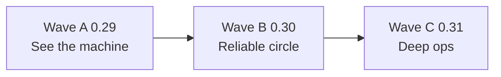

# Spec: SeraBot Big Wave — visibility, reliability, deep ops

Status: **approved** 2026-11-09 (owner big-wave update proposal). Baseline:
multi-user reconstruction **implemented** (`tasks/todo.md`); 0.28.0 harness and
visibility **mostly shipped** (`docs/specs/release-0.28.0.md`,
`tasks/release-0.28.0.md`). Executable checklist: `tasks/big-wave.md`.

## Objective

Ship a sequenced Big Wave (releases **0.29 → 0.31**) that makes SeraBot feel
reliably autonomous, observable, and operator-friendly for a ≤ ~10-user
invitation-only circle — still one Rust binary, one SQLite/WAL database,
deterministic Rust around bounded LLM calls. No new services.

Success at a glance: each wave merges with the full workspace gate green;
acceptance checks in this spec and `tasks/big-wave.md` are satisfied; operators
see routines, source health, and active plans in one place; tool runs are
traceable without leaking secrets; vault external providers are probeable;
scheduled work is owned per user, not admin-only.

## Baseline (repo facts)

| Area | State |
| --- | --- |
| Multi-user | Implemented — UID-scoped store, gateway authority, per-user secrets/fleet. |
| Autonomy harness | 0.28 Phase A shipped — destructive-only approvals, `yolo_toggle`, 16 handoffs. |
| Visibility | Jobs panel, logs ring buffer, previews, SSE activity steps. |
| **Gap driving Wave A** | 0.28 **C2** — routines/workflows **not** surfaced in console (`tasks/release-0.28.0.md`). |



*Caption: three sequential waves; each wave is releasable on its own gate.*

## Theme 1 — Features check (improve / missing)

| Strength | Weakness / gap | Big Wave response |
| --- | --- | --- |
| Durable turn loop, gateway, bots/skills/memory/RAG, jobs/media, personal tasks, teams, cards/vault, connectors | Plans only per conversation; routines in DB but no HTTP list; monitoring file-based with no health API | Wave A read APIs + Workflows tab; Wave B per-user routine CRUD and merged watch/brief UX |

**Missing (addressed across waves):** unified Workflows tab (A4); per-member
routine schedules (B1); per-user source overlay (B3); standing-grant UI (B5);
stuck/unknown jobs filters (B6).

## Theme 2 — Autonomy

| Strength | Weakness | Big Wave response |
| --- | --- | --- |
| YOLO + audit, delegate fan-out, turn limits, `plan_update` reinjection | Scheduled autonomy admin-centric (`conversation_id: "owner"` seeds); standing grants opaque; failed `source_runs` do not trigger deterministic follow-up | B1 member routine targets; B4 reliability enqueue rules (capped, no LLM loop); B5 grants visibility; C3 prompt presets reference Workflows + `watch_now` |

**Missing (explicit non-goals below):** free-form agent-to-agent orchestration;
unbounded proactive LLM turns on every threshold.

## Theme 3 — Logging and tool traces

| Strength | Weakness | Big Wave response |
| --- | --- | --- |
| Audit `tool.completed` / `tool.failed`, `GET /v1/audit`, usage rollups, owner Logs + `GET /v1/logs`, safe SSE step labels | Ring logs unstructured; audit is flat pagination; no turn-scoped timeline | A5 `GET /v1/traces`; A7 gateway `tracing` spans (`user_id`, `turn_id`, `tool`); B6 link jobs to traces |

Traces and logs stay **redacted** — hashes, destination, elapsed_ms only; never
canonical secret args.

## Theme 4 — Reliability routines and Workflows

| Strength | Weakness | Big Wave response |
| --- | --- | --- |
| `watch_all`, brief builder, `watch_now`, durable scheduler, `source_runs` on failure | Schedules in config + DB; sources in TOML; outcomes in SQLite — nothing merged in UI; watch tied to admin-seeded `watch_{n}` | A1–A4 Workflows surface: routines status, source health, active plans; B2 single-screen brief/watch; B3 per-user source overlay; B4 failed-run enqueue |

Workflows remain **stored plans + tasks + scheduler** — no new workflow engine.

## Theme 5 — Browser and vault

| Strength | Weakness | Big Wave response |
| --- | --- | --- |
| Per-user browser profiles, live view API, bot tools, allowlists; vault local + 1Password/Proton via CLI; desktop Vault UI | AI providers have Test; vault PMs show cli/config only — no probe; browser settings scattered | A6 vault provider test endpoint; C1 browser console upgrades; C2 unified accounts/credentials view |

External vault means **1Password / Proton Pass via CLI**, not new cloud vault SaaS.

## Theme 6 — Extras (not in the original six bullets)

1. Finish **0.28 C2 semantics** as part of Wave A (scheduler + plans UI, not a new engine).
2. **Member routine parity** — personal bots deserve personal schedules (B1).
3. **Standing grants & approval hygiene** — list/revoke (B5).
4. **Quota guardrails** — surface near-limit in console (existing usage API).
5. **Worker reliability UX** — `outcome_unknown` / stuck tasks in Jobs (B6).
6. **Mobile parity** — Flutter read-only Workflows/traces (C5).
7. **Mem0 path** — document/console toggle if `[memory] provider = "mem0"` is in use.
8. **In-repo plan** — this spec + `tasks/big-wave.md` (this document).

---

## Wave A — See the machine (0.29.0)

**Theme:** Operator visibility and reliability **read** APIs; minimal new policy.
Completes 0.28 C2 **read path** and observability v1.

| Id | Feature | Target modules | Acceptance |
| --- | --- | --- | --- |
| A1 | Routines list + status API | `store.rs`, `api/routines.rs`, `api/mod.rs` | `GET /v1/routines` returns acting user's rows: name, enabled, next_run_at, last_run_for, config JSON; member cannot see others'; UID tests in `api/tests/`. |
| A2 | Monitoring health API | `store.rs`, `brief.rs`, `api/watcher.rs` | `GET /v1/monitoring/sources` returns configured source names (`load_sources`) + last run ok/error/items_seen for acting user; no HTML bodies. |
| A3 | Active workflows API | `plans.rs`, `api/plans.rs` or `conversations.rs` | `GET /v1/workflows/active` lists conversations with incomplete plans (goal, done/total, updated_at). |
| A4 | Desktop Workflows tab | `serabot-desktop` (`ui_workflows.rs`, `ui.rs`, `session.rs`) | Tab shows next routines, source health, active plans; Refresh works outside chat; matches Jobs/Logs styling. |
| A5 | Tool timeline (read-only) | `store.rs`, `api/traces.rs` | `GET /v1/traces?conversation_id=&limit=` returns redacted `tool.*` + approval events in order; never returns secret canonical args. |
| A6 | Vault provider test | `vault_providers.rs`, `api/vault.rs`, `ui_vault.rs` | `POST /v1/vault/providers/{id}/test` returns exit-code style `{ok, cli_found, configured, message}`; no token/value; HTTP test in `api/tests/vault_http.rs`. |
| A7 | Logging correlation (light) | `gateway.rs`, `logging.rs` | `tracing` spans with `user_id`, `turn_id`, `tool` on tool path; owner Logs can filter/search by tool name; daily file remains redacted. |

**Parallelization:** A1/A2/A3 server APIs (disjoint files); A4 depends on A1–A3;
A5–A7 parallel after trace/redaction contract agreed.

**Chat UX:** polish from 0.28 D1 (streaming, WIP steps) continues in parallel for
Wave A demo quality; no redesign beyond existing console pages.

---

## Wave B — Reliable circle (0.30.0)

| Id | Feature | Target modules | Acceptance |
| --- | --- | --- | --- |
| B1 | Per-user routine CRUD | `scheduler.rs`, `store.rs`, `api/routines.rs`, `config.rs` | User enables/disables/sets time+tz for `morning_brief` and custom daily runs for self; enqueue uses member default conversation, not hardcoded `"owner"`. |
| B2 | Merge watch into routines UX | `main.rs`, `runtime/schedules.rs`, Workflows UI | One screen: brief time, watch times, manual “Run all sources”; tasks still `kind=watch` / `brief`. |
| B3 | Per-user source overlay (v1) | migration `user_sources` or scoped `SourceConfig`, `watcher.rs`, `load_sources` | Member enables admin-defined subset or adds allowlisted RSS; no fetch outside `SafeFetcher` rules. |
| B4 | Reliability enqueue rules | `runtime/schedules.rs` or `reliability.rs` | If `source_runs.ok=0` for N hours, enqueue **one** watch task or `events` row — capped per day, no LLM loop. |
| B5 | Standing grants API + UI | `store.rs`, `api/approvals.rs`, desktop Settings/Workflows | List/revoke grants for acting user; audit `standing_grant.revoked`. |
| B6 | Jobs panel: stuck/unknown | `api/jobs.rs`, `ui_jobs.rs` | Surface uncertain tasks + `outcome_unknown` actions; link to trace. |

---

## Wave C — Deep ops + browser/vault polish (0.31.0)

| Id | Feature | Target modules | Acceptance |
| --- | --- | --- | --- |
| C1 | Browser console upgrades | `ui_browser.rs`, `api/browser.rs`, `browser/manager.rs` | Profile picker, last host, idle TTL visible; sign-in helper status. |
| C2 | Vault “accounts” view | `vault.rs`, `cards.rs`, `ui_vault.rs` | Unified list: local + external refs + card-backed; domain filter; last used from `vault.resolve` audit. |
| C3 | Autonomy presets | `bots/`, `fleet.rs`, `runtime/prompts.rs` | Shipped watcher/analyst prompts reference Workflows + `watch_now` + `plan_update`; no new tools. |
| C4 | Admin reliability dashboard | `api/admin.rs`, `sysstatus.rs` | Admin-only: scheduler lag, routine claim failures, source staleness (counts only). |
| C5 | Flutter Workflows + traces | `apps/serabot_mobile` | Read-only parity with desktop Workflows. |

---

## Non-goals (`AGENTS.md` product boundary)

- No open self-signup, Docker, PostgreSQL, Node runtime, or local chat LLM.
  The plugin marketplace is an approved catalog and per-user install record.
  Do not add a runtime that calls plugin servers.
- No web UI beyond existing console pages (landing, login, health, downloads)
  plus the **existing** desktop/mobile clients — Workflows is a new **tab**, not
  a new public site.
- No cross-user credential reads; admin sees audit/metadata only.
- All tool execution and outbound effects stay through `gateway` — no bypass of
  approvals, policy scanning, or audit.
- No model-chosen arbitrary filesystem paths; inboxes only.
- No free-form agent-to-agent chatter; workflows remain plans + tasks + scheduler.
- OVH/production: read-only unless the owner authorizes additive install; never
  delete/restart/reconfigure existing services without explicit OK.
- Tests and public repo content stay synthetic; never commit secrets, blocklists,
  or private dossier material.

## Risks and open questions

| Risk | Mitigation |
| --- | --- |
| Per-user sources (B3) expand attack surface | Reuse `SafeFetcher`, blocklist on titles/URLs, size caps like `watcher.rs`. |
| Tool traces leak args | Expose tool name, hashes, destination, elapsed_ms only — same pattern as approval cards. |
| Routine conversation routing | Product call before B1 merge: default Telegram binding vs `dir:main` per user. |
| Proton Pass CLI variance | Test endpoint exit-code-only (`vault_providers.rs` caveat). |
| Wave A UI blocked on APIs | Land A1–A3 (+ A5/A6) before A4 desktop tab. |

**Assumptions:** Wave A completes **0.28 C2** semantics (surface scheduler +
plans). “External vault” = 1Password/Proton Pass CLI references already in tree.

## Suggested two-week cut (Wave A starter)

| Week | Deliverables |
| --- | --- |
| **Week 1** | A1 + A2 + A3 (store methods, APIs, tests); A6 vault test endpoint; this spec + `tasks/big-wave.md` tracked in-repo. |
| **Week 2** | A4 Workflows tab (desktop); A5 traces MVP; A7 tracing fields in `gateway.rs`; gate + owner demo: routine countdown, red source row, active plan, vault “Test OK”. |

## Verification gate (every chunk)

```bat
scripts\cargo-win.bat check --workspace --all-targets
scripts\cargo-win.bat test --workspace --locked
```

WSL before wave commit: `cargo fmt --all -- --check`, `cargo clippy --workspace
--all-targets -- -D warnings`, full test. Flutter when mobile touched:
`flutter analyze` / `flutter test` in `apps/serabot_mobile`.

**Manual smoke:** Two users — member sees own routines/workflows only; owner Logs
+ traces show a browser tool run without secrets; vault test with missing CLI
fails gracefully.

## Success criteria (wave-level)

1. **Wave A:** APIs and Workflows tab green; traces redacted; vault test safe;
   0.28 C2 operator intent met for read/schedules/plans visibility.
2. **Wave B:** Member can own brief/watch schedules; reliability rules enqueue
   deterministically; grants manageable; jobs surface stuck work.
3. **Wave C:** Browser/vault UX coherent; admin reliability counts; mobile
   read-only Workflows; prompts aligned with ops surfaces.

## Related documents

- Product boundary: `AGENTS.md`
- Prior release: `docs/specs/release-0.28.0.md`, `tasks/release-0.28.0.md`
- Reconstruction: `docs/specs/multi-user-reconstruction.md`, `tasks/todo.md`
- Browser/vault contracts: `docs/specs/browser-profiles-contract.md`,
  `docs/specs/vault-browser-contract.md`
